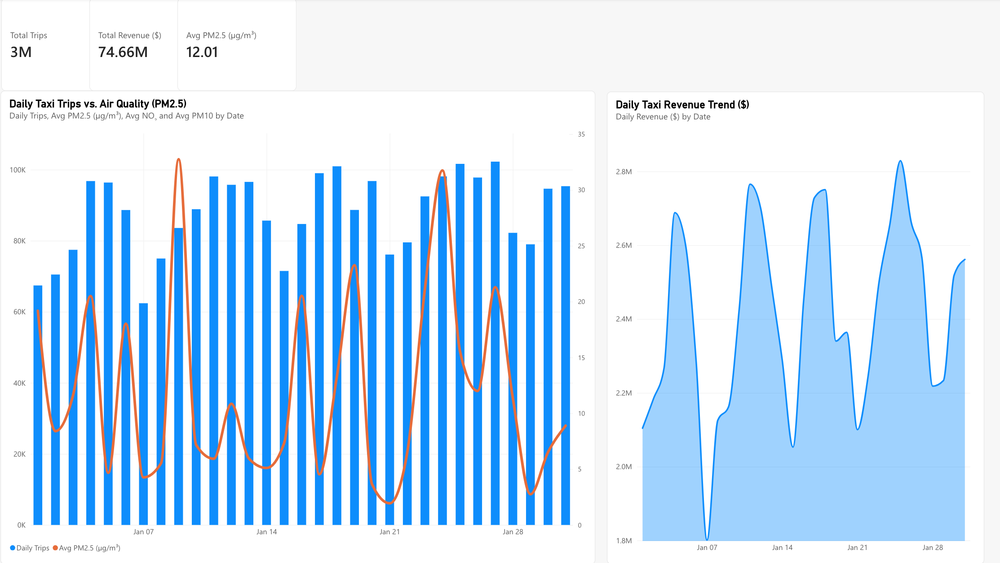

# NYC Taxi & Air Quality Data Engineering Pipeline (Microsoft Fabric)

An end-to-end Data Engineering project built in **Microsoft Fabric** using the **Medallion Architecture (Bronze → Silver → Gold)** to analyze the relationship between New York City Yellow Taxi traffic and urban air quality (PM2.5, PM10, NO₂) in January 2024.

## Architecture & Tech Stack
* **Platform:** Microsoft Fabric (Lakehouse, Notebooks, Data Pipeline, Semantic Model, Power BI)
* **Storage Format:** Parquet / JSON (Bronze) → Delta Lake Tables (Silver & Gold)
* **Languages:** Python (PySpark) & Spark SQL
* **Data Sources:**
  * **NYC TLC Trip Record Data:** January 2024 Yellow Taxi Trips (`.parquet`)
  * **Open-Meteo Air Quality API:** Hourly NYC PM2.5, PM10, and NO₂ metrics (`.json`)

## Pipeline Stages & Orchestration
1. **Bronze Layer (Raw Ingestion):** Automated ingestion of raw Parquet and JSON files directly via URL into Lakehouse `Files/bronze/`.
2. **Silver Layer (Cleaning & Transformation):**
   * Filtered invalid dates, zero/negative trip distances, fares, and passenger counts (`silver_nyc_taxi`).
   * Flattened nested hourly JSON arrays and enforced timestamp/numeric schemas (`silver_nyc_air_quality`).
3. **Gold Layer (Business-Ready Analytics):**
   * Aggregated daily taxi metrics (`gold_taxi_daily_summary`) and daily air quality averages (`gold_air_quality_daily`).
   * Joined both datasets on `date` into a unified table (`gold_taxi_air_quality_combined`) for BI reporting.
4. **Orchestration (`PL_NYC_Taxi_AirQuality_EndToEnd`):**
   * Automated sequential execution of `01_NYC_Taxi_Medallion` → `02_AirQuality_Medallion` using a Microsoft Fabric Data Pipeline.
   * Configured with an **On Success** dependency and a **Retry Policy** (2 retries, 60s interval) to gracefully handle Spark capacity concurrency limits.

## Dashboard Preview
Key findings for January 2024: **3M total trips**, **$74.66M total revenue**, and an average **PM2.5 level of 12.01 µg/m³**.

## Repository Structure
* `01_NYC_Taxi_Medallion.ipynb` — NYC Taxi Bronze, Silver, and Gold pipeline
* `02_AirQuality_Medallion.ipynb` — Air Quality ingestion, JSON flattening, and final Gold join
* `dashboard.png` — Power BI Dashboard preview
